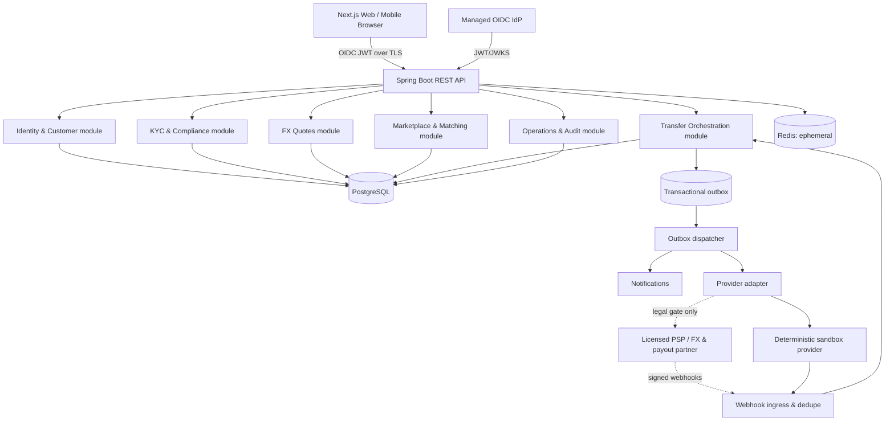
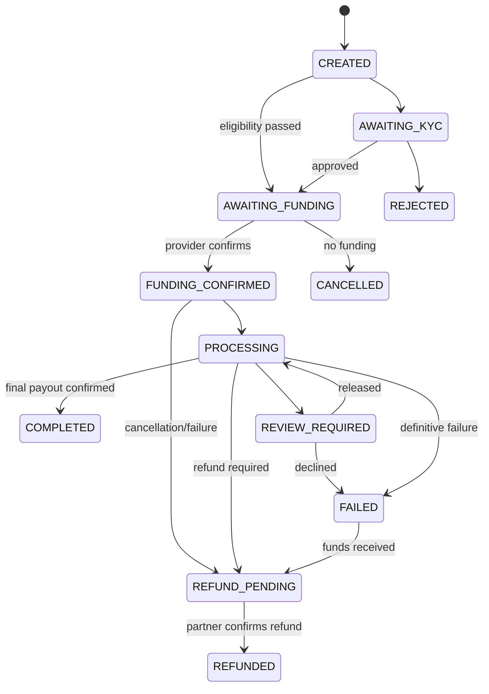

# Architecture decision record and workflows

## 1. Design principles

- **One modular monolith** for early product: one Spring Boot deployable, well-defined domain boundaries.
- **Single source of truth** in PostgreSQL; Redis only for cache, session-related ephemeral data and rate limiting.
- **Contract-first** OpenAPI, schema migrations, generated typed TS API client, consumer contract tests.
- **No double spending / overselling:** use DB transactions, row locks/optimistic versions and unique constraints.
- **Third-party provider isolation:** simulator behind `PaymentGateway`, `FxRateProvider`, `IdentityProvider`, `ComplianceScreening` ports; no provider type leakage into public API.
- **Fail closed for live financial operations:** environment-level gate AND permitted-corridor DB policy AND authorized-provider binding AND compliance eligibility; production rollout requires human approval.

## 2. Component map

## 3. Bounded contexts

| Module | Owns | Must not do |
|---|---|---|
| Identity | Authenticated customer mapping, profiles, permissions | Store passwords or raw ID documents |
| Beneficiary | Recipient destination references, masked banking detail | Expose destination details in public marketplace |
| Compliance | KYC case status, screening result, limits, operator decisions | Auto-approve missing verification |
| FX Pricing | Partner/simulated quotes, fee calculations, expiry | Promise a market rate without provider backing |
| Marketplace | Offers, matching candidates, reservation, bilateral acceptance | Settle funds, hold escrow or publish personal info |
| Transfers | Transfer state machine, provider instructions, refund workflow | Mark completed before verified payout acknowledgement |
| Reconciliation | Provider statement comparison, discrepancies | Invent partner payment evidence |
| Audit/Outbox | Immutable transition history and at-least-once messages | Store secrets in logs |

## 4. Critical invariants

1. One `user_id` is bound to one verified OIDC identity `sub`; access to mutable resources is owner-scoped by SQL predicate plus service authorization.
2. No transition from terminal (`COMPLETED`, `FAILED`, `CANCELLED`) except a separately modeled corrective workflow (`REFUND_PENDING` → `REFUNDED`) where valid.
3. Quotes expire server-side, not by trusting client clock.
4. `POST /transfers` is idempotent per actor+operation+key; identical retry returns same transaction; differing payload yields `409`.
5. Callbacks are verified by signature, timestamp, merchant/provider account, and transaction reference; any out-of-order callback is logged and reconciled, never used to skip intermediate mandatory checks.
6. One provider event is applied at most once (`provider,event_id` unique); at-least-once delivery is expected.
7. Matching cannot reduce offer inventory twice; reservations are committed atomically.
8. No customer wallet/account or real-money liability is maintained by the application in MVP. Statuses are evidence-backed workflow facts, not balances.
9. `liveEnabled=false` by default for all combinations. No direct P2P sender-to-sender transfer or informal two-country offsetting.
10. FX matching and settlement are separate capabilities; `AGREED_SIMULATION_ONLY` does not mean paid.

## 5. Transfer state machine

- `FAILED` is only terminal when no refund remains due; when money was funded, transition into `REFUND_PENDING` as needed.
- `REJECTED` and `CANCELLED` are also terminal when no funds were received.
- A state may be skipped **only** by a documented provider-specific reconciliation transition with equivalent verified evidence and audit log.
- Process timeouts should raise review alerts, not automatically imply successful payout.

## 6. P2P matching

- Model offer as seller selling source currency and buying target currency at `limit_rate` target units/source unit.
- Reciprocal offers A (EUR→MAD) and B (MAD→EUR) compare with canonical conversion to MAD/EUR. The algorithm should compute the feasible interval with precise inverse logic, not naive rate comparison of reciprocal numbers.
- For A selling EUR and demanding at least `R_A` MAD/EUR, and B selling MAD and demanding at least `r_B` EUR/MAD, a canonical trade rate `R` is feasible only if `R_A <= R <= 1/r_B` after precision-safe decimal comparison. Verify full-amount conservation after quantization to minor units.
- MVP requires full-fill matches for both sides; if incompatible denominations or amounts, do not match. Add partial matching via an ADR after deterministic property-based tests.
- Matching transactions acquire offer row locks in stable UUID order (`SELECT ... FOR UPDATE`) to prevent deadlocks and double reservation.
- A proposed `fx_match` holds `reservation_source_minor` and `reservation_counter_minor` with both users' confirmation status and expiry.
- On both accept: `AGREED_SIMULATION_ONLY` in MVP. In a future licensed settlement flow, an explicit second eligibility/quote step is required.
- Expiration or rejection releases reservations exactly once via an idempotent job.

## 7. External contracts

- `FxRateProvider`: `quote(direction, amount, purpose, client)` returns rate, fees, currency, expiry, partner ref, availability.
- `IdentityVerificationProvider`: initiate session; process signed status event; store provider token and decision only.
- `PaymentGateway`: create transfer (only after gates), query status, request cancel/refund, poll provider; all with idempotency.
- `ScreeningProvider`: sanctions/PEP/adverse-media check and traceable decision (requirements determined by partner's compliance program).
- Each provider has separate staging/live credentials, sandbox-only bootstrap and environment guardrails.

## 8. Deployment and observability

- Dev: Docker Compose for PostgreSQL/Redis + mock provider; Spring Boot and Next.js locally.
- Staging: isolated database, mocked/sandbox external systems, scrubbed synthetic data, preview deployment.
- Production: EU-hosted workloads initially, managed database with encryption/backups, WAF, least-privilege network policies, secret manager, strong admin MFA.
- Instrument traces `trace_id`, `correlation_id`, `quote_id`, `transfer_id` and partner references (redacted). Emit counters for invalid transition, failed webhooks, idempotency conflict and reconciliation mismatch.
- Transactional outbox is written atomically with domain transition; worker retries with jitter and idempotent delivery. No Kafka in first milestone.

## 9. Architecture decision records

- ADR-001: modular monolith over premature microservices.
- ADR-002: ledger of immutable operational events, no customer balances or e-money issuance in MVP.
- ADR-003: authorized partner manages all money movement; separate flow-specific gate per country/direction.
- ADR-004: canonical FX rate and integer currency minor units.
- ADR-005: P2P matches are offers of intent, not implicit transfers.

### ADR-006 — Generate the client and check contract compatibility in CI

Use the OpenAPI document as the source for the TypeScript fetch client. A pinned generator validates the document and rebuilds the client from scratch so frontend checks compile against the proposed contract. CI compares the proposal against the target revision and fails on potential or definite breaking changes.

Reuse the existing `Problem` response for simulated webhook errors and unexpected server errors. The server uses fixed client-safe messages and generates a correlation ID for each error. The error response additions require no database migration.
