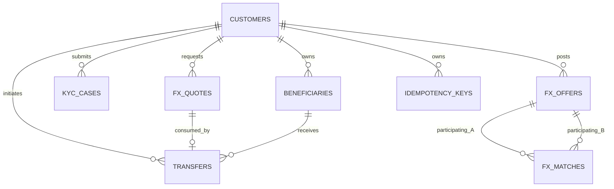

# Domain data model

## Entity relationship overview

`FX_MATCHES` has two foreign keys back to `FX_OFFERS`. `TRANSACTION_EVENTS`, `OUTBOX_EVENTS`, `AUDIT_EVENTS`, and `WEBHOOK_EVENTS` store state/evidence rather than customer balances.

## Tables and ownership

| Table | Primary fields | Integrity/ownership |
|---|---|---|
| `customers` | UUID id, OIDC subject, residency_country, status | unique OIDC subject; authorization uses customer ID |
| `kyc_cases` | user, provider, external ref, decision/status | never store raw document scans |
| `beneficiaries` | owner, label, country, payout method, provider destination token | private; no raw banking credentials in publicly exposed records |
| `fx_quotes` | user, direction, rate, amounts, fees, expiry, mode | immutable pricing inputs; one-time use |
| `transfers` | user, quote, beneficiary, purpose, workflow status, provider refs | quote unique; idempotent create; strict state machine |
| `fx_offers` | owner, pair, source_total/reserved/filled, limit rate, expiry, version | `reserved + filled <= total`; no overselling |
| `fx_matches` | two reciprocal offers, reserved amounts, accept flags, expiry, status | users accept separately; no money movement |
| `idempotency_keys` | actor, operation, key, request hash, resource | same key+different body = 409 |
| `webhook_events` | provider, event id, signed payload digest, outcome | provider-event unique; dedupe/replay controls |
| `transaction_events` | kind/id, old/new state, reason, correlation | append-only, immutable operational history |
| `audit_events` | actor, operation, resource, minimal metadata | immutable audit records; protected access |
| `outbox_events` | aggregate, event type, payload, delivery state | written in same DB transaction as domain update |

## Amount and FX rate conventions

- Every money field suffixed `_minor` is integer minor units and always paired with a currency.
- Rate is **target currency per 1 source currency**, persisted `NUMERIC(22, 12)`. Example `EUR→MAD` rate `10.70` is **illustrative**, not live.
- An opposite `MAD→EUR` offer uses the reciprocal convention and must be normalized before compatibility testing.
- `source_filled_minor` means **marketplace capacity already committed to an agreed match**, not cash payment or financial settlement. The actual MVP remains simulation-only.
- `target_amount_minor` is calculated by an explicit quantization policy, validated against the partner's quote. Refunds, reversal amounts and fees remain separate event facts; never overwrite original quote.
- All fields stored in database BIGINT, but exposed over JSON as **decimal strings** to avoid JavaScript >2^53 precision loss.

## Concurrency rules

- Match both offers inside one PostgreSQL transaction with deterministic locking order and version increment.
- Compute available `total - reserved - filled`, and assert availability before reservation.
- Use unique `(provider, provider_event_id)` for callback idempotency.
- Use unique `(customer_id, operation, idempotency_key)` for request dedupe and store a hash of canonical request bytes.
- Use unique `transfers.quote_id` to prevent a customer using a quote for multiple transfers.
- Workers claim outbox rows using `FOR UPDATE SKIP LOCKED` and commit state changes atomically.

## Indexes and partitions

- `fx_offers (source_currency, target_currency, status, expires_at)` for live-offer discovery.
- `transfers (customer_id, created_at DESC)` for dashboard history.
- `fx_quotes (customer_id, expires_at)` for cleanup/lookup.
- `fx_matches (offer_a_id)` and `(offer_b_id)` for releasing reservations.
- `outbox_events (status, next_attempt_at)` for workers; `webhook_events(provider, provider_event_id)` unique.
- Consider time-range partitioning for immutable events only after demonstrating volume.

## Retention and deletion

- PII minimization and documented retention schedule; legal audit and AML retention may require exceptions to normal erasure workflows.
- Soft delete beneficiaries to keep historical traceability while hiding them from active views.
- Partition/anonymize telemetry separately from transaction evidence; never use a transaction deletion to erase regulatory evidence without a defined policy.

## SQL baseline

`db/migration/V1__core_domain.sql` is an initial reviewable Flyway migration. Production needs additional policy tables, migrations and partner schema after compliance/partner contracts are finalized.
